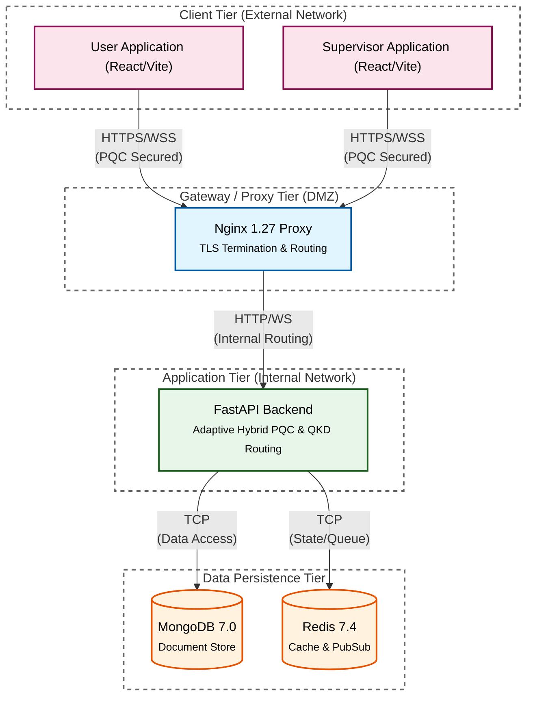

# Adaptive Hybrid Post-Quantum Secure Communication System


## Overview

A robust, full-stack secure communication system integrating post-quantum cryptography (PQC) and simulated quantum key distribution (QKD). The architecture heuristically provisions security algorithms based on connection metadata, user priority, and simulated threat thresholds.

### Features
- Heuristic Security Routing based on Threat Levels
- Kyber-768 for Key Encapsulation (KEM)
- Dilithium-3 for Digital Signatures
- AES-256-GCM for Symmetric Encryption
- Simulated QKD Key Distribution
- Real-time messaging via WebSockets
- Dedicated Supervisor Dashboard

## Architecture



## Threat Analyzer & Cryptographic Dispatch

The system evaluates incoming message payloads and determines routing via an adaptive, resource-aware decision model:

1. **Normalized Security Demand (Eq. 1):**
   $$QTL(f) = w_1 S + w_2 I, \quad w_1 + w_2 = 1.0$$
   - $S \in [0.0, 1.0]$: Payload sensitivity score derived from file extension tiers and keywords.
   - $I \in [0.0, 1.0]$: Normalized sender authorization priority ($I_{raw} / 10.0$).
   - Default weights: $w_1 = 0.60, w_2 = 0.40$.

2. **Dynamic Switching Threshold (Eq. 4):**
   $$a(t) = \frac{A_K(t)}{K_{max}}, \quad \tau_{eff}(a) = \tau_{min} + (\tau_{max} - \tau_{min})(1 - a)$$
   - Adapts the threshold based on QKD reservoir availability $A_K(t)$ relative to capacity $K_{max} = 20$.
   - $\tau_{min} = 0.40, \tau_{max} = 0.80$. When keys are scarce ($a \to 0$), the threshold rises to conserve keys.

3. **Routing Decision & Critical Override (Eq. 5):**
   $$Switch(f) = \begin{cases} \text{QKD}, & QTL(f) \ge \tau_{eff}(a) \;\text{or}\; S \ge S_{crit} \\ \text{PQC}, & \text{otherwise} \end{cases}$$
   - Payloads with $S \ge S_{crit} = 0.85$ (e.g., credentials, certificates) automatically request the QKD-assisted path.

4. **Deadline-Bounded Priority Queue (Eq. 6-8):**
   - If QKD keys are exhausted, critical messages buffer in a Redis min-heap sorted by $\pi(f) = (-QTL(f), t_{arr}(f))$.
   - If wait time $t_{wait} = t_{now} - t_{arr} > T_{deadline}$ ($5.0\text{ s}$), messages are safely dropped and logged to telemetry to prevent unbounded delays.

5. **Defense-in-Depth Hybrid Key Derivation:**
   - On the QKD path, the session key combines the simulated QKD key and ML-KEM shared secret:
     $$K_{master} = \text{HKDF-SHA-256}(qkd\_key \parallel kem\_secret,\; context)$$
   - ML-DSA-65 digitally signs $(kem\_ct \parallel ct \parallel header)$ for end-to-end authenticity.

## Prerequisites
- Docker & Docker Compose
- Node.js 20+ (for local development)
- Python 3.11+ (for local development)

## Quick Start

1. **Clone the repository**
2. **Generate environment configuration**
   ```bash
   ./infra/scripts/generate_env.sh
   ```
3. **Start the infrastructure**
   ```bash
   make up
   ```
4. **Access Applications**
   - User Client: http://localhost:5173
   - Supervisor Dashboard: http://localhost:5174
   - API Docs: http://localhost:8000/docs
5. **Seed Demo Users**
   ```bash
   make seed
   ```

## Development Setup

Use the provided Makefile for convenience:
- `make dev-backend`: Run FastAPI backend locally
- `make dev-user`: Run User frontend locally
- `make dev-supervisor`: Run Supervisor frontend locally
- `make install`: Install all dependencies across services
- `make test`: Run pytest in backend container

## Technology Stack

| Service | Tech |
|---|---|
| Backend | Python, FastAPI, Motor (MongoDB), passlib |
| Frontend User | React, Vite, Tailwind CSS (optional) |
| Frontend Supervisor | React, Vite, Tailwind CSS (optional) |
| Database | MongoDB 7.0 |
| Cache/PubSub | Redis 7.4 |
| Proxy | Nginx 1.27 |

## Project Structure
```
pqc-secure-comm/
├── backend/                  # FastAPI Application
├── frontend-user/            # React User SPA
├── frontend-supervisor/      # React Supervisor SPA
├── infra/                    # Infrastructure configs
│   ├── mongo/
│   ├── nginx/
│   ├── redis/
│   └── scripts/
├── docker-compose.yml
├── Makefile
└── README.md
```

## License
MIT License
